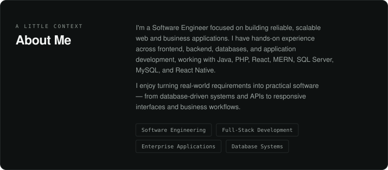
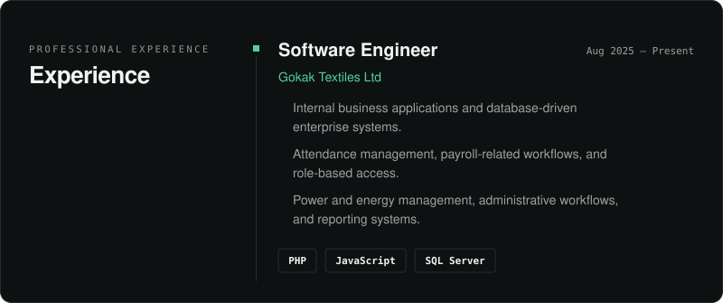
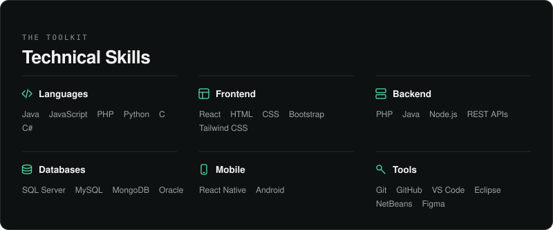
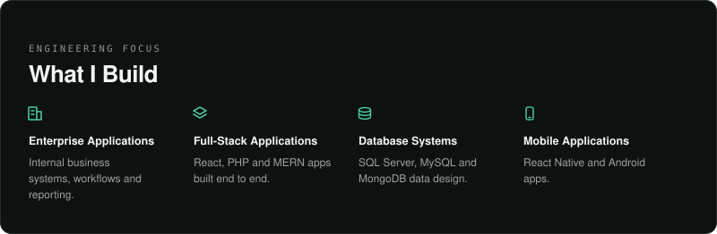
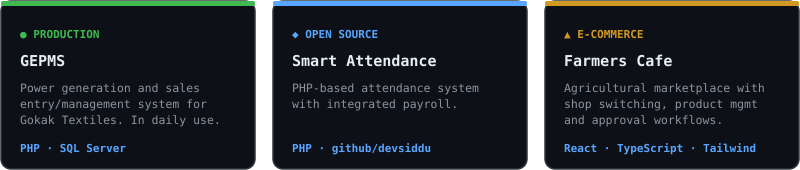

  

<h2 align="center">Hi, I'm Siddu 👋</h2>

  <code>Software Engineer @ Gokak Textiles Ltd</code> 
  Building reliable, scalable web and business applications.

  <a href="https://spirestack.vercel.app">Portfolio</a> &nbsp;·&nbsp;
  <a href="mailto:user.codespire@gmail.com">Email</a> &nbsp;·&nbsp;
  <a href="https://www.linkedin.com/in/siddudev">LinkedIn</a>

