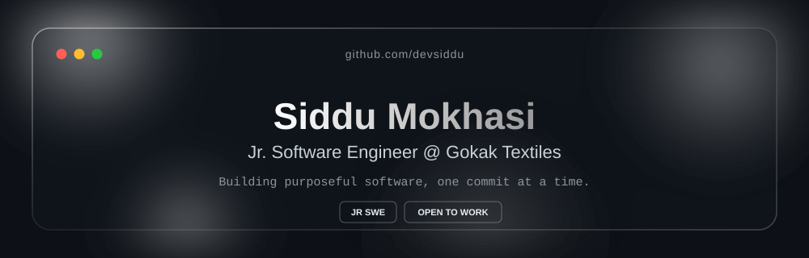
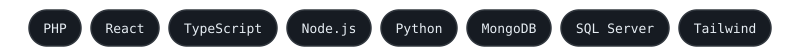

  

<h2 align="center">Hi, I'm Siddu 👋</h2>

  <code>Software Engineer @ Gokak Textiles</code> 
  Building practical web apps across PHP and MERN.

  <a href="https://spirestack.vercel.app">Portfolio</a> &nbsp;·&nbsp;
  <a href="mailto:user.codespire@gmail.com">Email</a> &nbsp;·&nbsp;
  <a href="https://www.linkedin.com/in/siddudev">LinkedIn</a> &nbsp;·&nbsp;
  <a href="https://github.com/devsiddu/smart-attendence-php">Smart Attendance</a>

  

## Selected Work

  

## Stack

  

